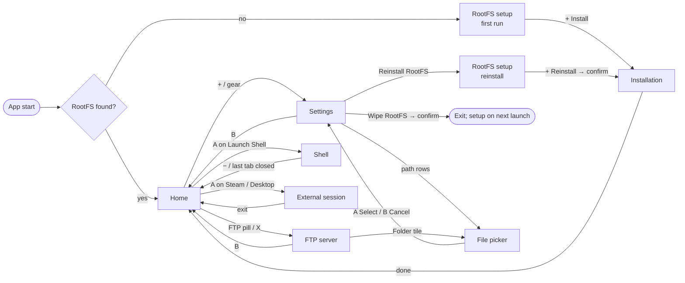

# FEX for Switch 2 — UI Design Spec

Nov 23, 2026 · @Julian Vogel

> **For Claude Code:** this is the source of truth for geometry, behaviour and input. Companion file: `fex-switch2-theming-spec.md` (dark + light color tokens). The visual reference is the mockup canvas: https://claude.ai/artifact/7pCfQfj1AbmsKUK68p897V. Units are design units (du) on a 1280×720 canvas.

## Overview

Build the FEX for Switch 2 launcher as a native, GPU-rendered UI that matches the approved mockup pixel for pixel at 1280×720 and scales cleanly to 1080p and 4K. The mockup canvas is the visual source of truth; this spec is the source of truth for numbers, behaviour and input.

**In scope:** the screens Home, Settings (with About), RootFS setup, FTP server, Shell and Installation, one shared component set, controller + Joy-Con mouse + touch input, settings persistence.

**Out of scope:** the FEX emulator core, Steam or desktop session internals, the terminal emulator engine (Shell only needs its chrome and a VT renderer surface), any Nintendo logos or system fonts.

**Rules for the implementer**

- No web view, no HTML runtime. Draw everything with the 2D layer described below.
- Every size in this spec is in design units (du) on a 1280×720 canvas. Never hard-code device pixels.
- When this spec and the mockup disagree, the spec wins; flag the difference in the PR description.

## Rendering target

Render at the output's native resolution with one uniform scale factor `s = output_height / 720`; layout is computed once in design units and multiplied by `s` at draw time.

| Mode | Output | Scale s |
| --- | --- | --- |
| Handheld | 1920×1080 | 1.5 |
| Docked 1080p | 1920×1080 | 1.5 |
| Docked 1440p | 2560×1440 | 2.0 |
| Docked 4K | 3840×2160 | 3.0 |

- **Coordinates:** origin top-left, y down. Snap rectangle edges and 1 du hairlines to whole device pixels after scaling (a 1 du line is `max(1, round(s))` px).
- **Text:** rasterize glyphs at `size × s` from the TTF (glyph atlas per size), never scale a bitmap. Use grayscale AA, gamma-correct blending.
- **Shapes:** rounded rectangles, circles and rings via an SDF fragment shader or tessellated geometry with AA; no jagged corners at any scale.
- **Icons:** stroke icons on a 24-unit grid, rasterized from vector at the target size (nanosvg or pre-baked atlases at 1.5×, 2×, 3×).
- **Frame pacing:** vsync at 60 fps. Animations are time-based (ms), not frame-counted.
- **Backend:** a thin 2D layer (fill rect, rounded rect, ring, line, text run, image, clip rect) over the platform GPU API. The launcher is bare homebrew on libnx; SDL2 (the devkitPro switch-sdl2 portlib) + a custom batcher is the default; swap the backend without touching screen code.
- **Hot-plug:** on dock/undock, recompute `s`, rebuild glyph atlases, keep focus and scroll state.

## Design tokens

Define these once in a `theme.h` (or equivalent); screen code references token names only.

### Colors — launcher (Home, Settings, Installation, Shell hint bar)

| Token | Hex | Use |
| --- | --- | --- |
| `bg` | #1B1B1F | Screen background |
| `surface` | #2A2A30 | Cards, selected sidebar item, modal |
| `surface_raised` | #2C2C32 | Pill buttons, gear button, enum chips, app-icon tile |
| `surface_inset` | #34343B | Card icon tile, selected modal option |
| `field` | #26262B | Path value chip |
| `log_bg` | #121215 | Installation log window |
| `divider` | #34343A | Header/footer rules, row separators, log border, progress track |
| `text` | #F2F2F4 | Primary text, hint-glyph fill |
| `text_muted` | #A6A6AE | Secondary text, section headers |
| `text_field` | #DCDCE2 | Path values, log text |
| `text_dim` | #8A8A94 | Log timestamps |
| `accent` | #00C3E3 | Focus ring, enum values, toggle on, progress fill (user-selectable) |
| `toggle_off_track` | #4A4A52 | Toggle off track |
| `toggle_off_knob` | #C9C9D0 | Toggle off knob |
| `radio_off` | #6E6E78 | Unselected radio ring |
| `scrim` | #000000 @ 62% | Modal backdrop |
| `ok` | #4ADE80 | Log “ok” / success |
| `warn` | #FBBF24 | Log warnings |

Accent presets (Settings may expose these later): #00C3E3 (default), #E60012, #7C5CFF, #3DAEE9.

### Colors — Shell (KDE Breeze Dark)

| Token | Hex | Use |
| --- | --- | --- |
| `kde_window` | #202326 | Shell screen base |
| `kde_header` | #2A2E32 | Tab strip background |
| `kde_border` | #141618 | Tab strip bottom border |
| `kde_view` | #232627 | Terminal background, active tab |
| `kde_text` | #FCFCFC | Terminal foreground, active tab label |
| `kde_text_inactive` | #BDC3C7 | Inactive tab label, tab close icon |
| `kde_focus` | #3DAEE9 | Active tab top bar |
| ANSI green / blue / yellow / red | #1CDC9A / #1D99F3 / #FDBC4B / #ED1515 | Breeze terminal palette (bold variants same hue) |

### Typography

Bundle the TTFs (all SIL OFL): **Nunito Sans** (400/600/700/800), **JetBrains Mono** (400/600/700), **Noto Sans** (400/500, Shell tabs only).

| Style | Font | Size du | Weight | Used for |
| --- | --- | --- | --- | --- |
| `display` | Nunito Sans | 40 | 800 | Home title (letter-spacing −0.5) |
| `title` | Nunito Sans | 36 / 28 | 800 | Installation title / Settings title |
| `card_label` | Nunito Sans | 22 | 700 | Card labels, modal title |
| `row_label` | Nunito Sans | 18 | 700 | Settings rows, sidebar items |
| `body` | Nunito Sans | 16 | 600 | Footer hints, subtitles (400) |
| `caption` | Nunito Sans | 14 | 400 | Row descriptions, card subtitles |
| `section` | Nunito Sans | 14 | 700 | Section headers, UPPERCASE, tracking 0.6 |
| `meta` | Nunito Sans | 13 | 600 | “Version” label |
| `mono_ui` | JetBrains Mono | 15 / 13 | 600 / 400 | Version string / path values |
| `mono_term` | JetBrains Mono | 15, line height 1.55 | 400 (700 bold) | Terminal |
| `mono_log` | JetBrains Mono | 13, line height 1.7 | 400 | Installation log |
| `kde_tab` | Noto Sans | 13 | 400 | Shell tab labels |

### Shape and spacing

- Radii: card 20, focus ring 28 (card) / 15 (sidebar), modal 24, log 16, sidebar item 12, modal option 12, app tile 12, path chip 8, pill/circle 999.
- Screen side margin 48 (header) / 32 (footer rule inset) + 16 inner padding.
- Spacing scale: 4, 8, 10, 12, 14, 16, 20, 24, 28, 32, 48, 56.

### Icons

24-unit grid, round caps and joins, `stroke = currentColor`, no fill. Gear 1.8, card icons 1.5, chevrons 2.2–2.4, close 2.6. Set: gamepad (Steam), monitor (Desktop), terminal-square (Shell), gear, chevron-right, plus, x. Use Lucide icons (ISC; Feather-derived icons also MIT) and ship both notices; do not use the Steam or Nintendo logos.

## Shared components

Every screen is built from these; each component has one focusable hit rect, a `focused` and `pressed` state, and an `activate()` action.

| Component | Geometry (du) | Look | Behaviour |
| --- | --- | --- | --- |
| **FocusRing** | Outset 10 from target (4 on sidebar items), stroke 4 (3 on sidebar) | `accent`, radius = target radius + outset | Fades in over 100 ms ease-out; moves instantly between targets. Hidden in touch mode. |
| **VersionBlock** | App tile 44×44 r12 + 14 gap + two lines (gap 2) | Tile `surface_raised`, “FX” `mono_ui` 14/600 in `accent`; “Version” `meta` muted; version string `mono_ui` 15/600 | Not focusable. Text = `v<app> · FEX-<fex build>` from build constants. |
| **IconButton (gear)** | 56×56 circle, icon 28 | `surface_raised`, icon `text` | Focusable; ring outset 10, radius 38. |
| **LaunchCard** | 280×300 r20; icon tile 120×120 r28 centered; 28 gap; label + subtitle (gap 4) | `surface`; tile `surface_inset`; icon 64 stroke 1.5 | Focus ring outset 10. Press: scale 0.97 for 80 ms, then launch. |
| **PillButton** | Height 44, padding 0 18–20, radius 999 | `surface_raised`, `body` 15–16/700 | Focusable. Used for Browse, Restore defaults, enum chips. |
| **HintBar** | Height 64 (Shell 52), 1 du top rule `divider`, inset 32 + 16 padding | Left: muted status text. Right: hints, gap 28 | Each hint = 28 du circle glyph (`text` fill, `bg` letter 14/800) + 10 gap + label `body` 16/600. Hints are tappable/clickable and do the same as the button. |
| **SettingsRow** | Min height 68, padding 10 0, no row rules (removed 0.17.13), gap 24 | Label `row_label`, description `caption` muted (gap 2) | Whole row is the focus target; A acts on the control at the right. |
| **Toggle** | Track 56×32 r999, padding 3, knob 26; “On/Off” label 36 wide right-aligned, gap 12 | On: track `accent`, knob white, right. Off: `toggle_off_track`, knob `toggle_off_knob`, left | A / tap flips; knob slides 120 ms ease-out. |
| **EnumChip** | PillButton, padding 0 12 0 18, value + chevron 18, gap 8 | Value text in `accent` 16/700 | A opens **PickerModal**. Left/Right on the focused row cycles values without opening it. |
| **PathField** | Chip max 340 wide, padding 8 12, r8 + Browse PillButton, gap 10 | `field` bg, `mono_ui` 13 `text_field`, single line, ellipsis in the middle | A opens the File picker (see Screens); Browse is part of the row, not a separate stop. |
| **Slider** | Track 220 wide, value label 64 wide right-aligned `mono_ui` 15/600, gap 14 | Filled part `accent` | Left/Right step by `step`; hold to repeat; drag on touch/mouse. |
| **PickerModal** | Scrim full screen; dialog 520 wide, r24, padding 28, gap 8; title 22/800 + 12 below; option rows 56 high r12; Cancel 48 high pill, 12 above | Dialog `surface`; selected option bg `surface_inset`; radio 22 ring 2 (`accent` + 10 dot when selected, `radio_off` otherwise); Cancel `#3A3A42` | Opens with focus on the current value. Up/Down move, A selects + closes, B or tap on scrim cancels. Fade 120 ms. |
| **ProgressBar** | Height 12 r999 | Track `divider`, fill `accent` | Fill width eases to new value over 200 ms. Never moves backwards. |
| **LogView** | Fills available space, r16, 1 du border, padding 16 20 | `log_bg`, `mono_log` | Bottom-anchored, auto-scrolls to newest line; ring buffer of 2,000 lines; block cursor 8×15 on the last line, blink 530 ms. |

## Screens

All screens are 1280×720 du on `bg`, laid out as header / content / HintBar. Positions marked ≈ come from centring and may shift by a few du with font metrics; everything else is exact.

### Home

- **Header** (top padding 32, side 48, height 56): VersionBlock left, gear IconButton right.
- **Title block** (8 below header, centred): “FEX for Switch 2” `display`; 6 gap; “Run x86 and x86-64 Linux software on your console” `body` 16/400 muted.
- **Cards** (centred in remaining space, ≈ y 235): three LaunchCards, gap 56, row width 952, x = 164 / 500 / 836.

| Card | Icon | Label | Subtitle |
| --- | --- | --- | --- |
| 1 | gamepad | Launch Steam | Big Picture, controller-ready |
| 2 | monitor | Launch Desktop | Your configured desktop session |
| 3 | terminal | Launch Shell | Bash inside the x86 RootFS |

- **FTP pill** (centred, 56 below the cards: 28 gap + 28 top margin): 52 high, radius 999, `surface_raised`, padding 0 22 0 18. It holds a transfer icon (22), “FTP server” 16/700, a 1×20 du `divider` rule, then a status dot (8) and status text 16/600 in `text_muted`: “Running · N clients” with an `ok` dot, or “Off” with a `radio_off` dot. Down from any card focuses it; A opens the FTP server screen.
- **HintBar:** left “RootFS \<image> · \<free> GB free” (image name in `mono_ui`); right A Launch, B Exit, X FTP, + Settings. The “not affiliated” disclaimer lives on the About page.
- Card 1 is focused on first open; remember the last focused element across visits.

### FTP server

The FTP server is a background service, not a launch target, so it has a status pill on Home instead of a fourth card. Its screen is a full page with Settings chrome: a header with the server Toggle at the right (18/700 On/Off label), content, and a HintBar.

- **Address** (content padding 32 48 24): “Connect from your computer” 16 muted; 6 below, `ftp://<ip>:<port>` in JetBrains Mono 34/600, tracking −0.5. When stopped, it reads “Server is off”.
- **Credential tiles** (28 below): a 5-column grid, gap 16. Each tile is 84 high, r16, `surface`, padding 14 18: label 14/600 muted at the top, value in `mono_ui` 18/600 at the bottom (single line, ellipsis).

| Tile | Value | Top-right | Bottom-right | A / tap |
| --- | --- | --- | --- | --- |
| Username | `switch` | pencil 14 | — | Edit with the software keyboard |
| Password | `••••••••` | pencil 14 | eye icon 22, `text_muted`, no background or outline (crossed eye while shown); hit area 44×44 | A edits; the eye toggles visibility (also Y on a focused Password tile) |
| Port | 5000 | pencil 14 | — | Number pad, 1024–65535 |
| Folder | `/switch/fex/home` | pencil 14 | — | Folder picker |
| Keep running in apps | On / Off 18/700 | — | small Toggle 48×28, knob 22 | Flip |

- **Connected clients** (`section` header 36 below the tiles): rows min 72 high, bottom rule, grid `2fr 3fr 140 140`, gap 24.
  - Columns: app name 18/700 over IP in `mono_ui` 14 muted; activity 16 (“Receiving \<file> · 61%”, “Sending \<file>”, “Idle”); ↓ speed and ↑ speed in `mono_ui` 16, right-aligned.
  - ↓ means data going to the Switch and ↑ data leaving it. The active direction is 600 in `text`; a 0 B/s direction is muted.
  - Speeds refresh at 1 Hz, smoothed over 3 s. The list scrolls past the visible rows; A on a client asks “Disconnect \<app>?” (Cancel / Disconnect).
  - When the server is stopped, the list is replaced by one muted line: “Turn the server on to accept connections.”
- **HintBar:** left, when running “N clients · ↓ \<total> · ↑ \<total>”; when stopped “Passwords travel unencrypted; use trusted networks only”. Right: B Back, A Edit. Y starts or stops the server from anywhere on the screen.
- **Navigation:** focus starts on the header Toggle; Down goes to the tile row (Left/Right between tiles), then to the client rows.
- **Behaviour:** the server keeps running while any launcher screen is open. With Keep running in apps on, it also runs during Steam, desktop and Shell sessions. A random 8-character password is generated on first run.
- **Stored as** app keys `ftp_enabled`, `ftp_user`, `ftp_pass`, `ftp_port`, `ftp_root`, `ftp_background` in `ui.json`.

### Settings

> **Note:** The individual settings shown in the mockups and listed in this spec are examples only. They show the row types (path, enum, toggle, slider, link, destructive action) and how they look and behave. The actual set of settings will be decided later. Build the screen from the schema so the final list can be dropped in without layout work.

- **Header** (height 88, rule at bottom inset 32 + 16 padding): gear icon 32 + 14 gap + “Settings” 28/800 left; “Restore defaults” PillButton right.
- **Sidebar** (300 wide, padding 24 16 24 32): one item per section, 52 high, gap 8, r12, `row_label`. Selected item: `surface` bg + label in `accent`. Focused item also gets the FocusRing.
- **Content** (fills rest, 1 du left rule, padding 8 48 48 32, vertical scroll, body height 568): per section, 24 top padding, `section` header + 4 gap, then SettingsRows.
- Choosing a sidebar item smooth-scrolls (200 ms) its section to the top; scrolling the content updates the selected sidebar item (scroll-spy).
- Focus moves Right from sidebar into the first row of the selected section, Left from any row back to the sidebar.
- Section order: Paths, Desktop, CPU emulation, Graphics, Logging (rows and defaults in the schema below), then About pinned to the bottom of the sidebar.
- **HintBar:** left “Changes apply on next launch”; right B Back, A OK.
- **Restore defaults** asks for confirmation in a PickerModal (“Restore all settings?” → Restore / Cancel).

### Settings › About

About is the last sidebar item, separated from the settings sections by a 1 du `divider` rule with 16 above it, and pinned to the bottom of the sidebar. It has an info-circle icon (20 du, stroke 2) before the label. Selecting it replaces the right pane (no scroll-spy) with:

- **App block** (bottom rule, 20 below): app tile 72×72 r16 with “FX” `mono_ui` 22/600 `accent`; 20 gap; name 24/800, version `mono_ui` 15/600, one line 14 muted: “Homebrew launcher for FEX-Emu. Not affiliated with Nintendo, Valve, Canonical or KDE.”
- **“Bundled open-source components”** section, then **“Downloaded at runtime · not bundled”** section. Each entry is a focusable row (min height 60, bottom rule): name 17/700 + role 14 muted on the left; license chip (pill 32 high, `surface_raised`, `mono_ui` 13/600 SPDX id) + chevron on the right.
- **Footnote** 13 muted: where full license texts live, plus the trademark line.
- A on a row opens the **LicenseModal** (640 wide, same scrim and radius as PickerModal): name 22/800 + license chip in `accent`, one-paragraph obligation note 16, a `log_bg` box with `source` and `text` lines in `mono_ui` 13, Close pill. B or the scrim closes. A long license opens a full-screen scrollable text view from the `text` path.

The About list is generated from `licenses.json` (fields: name, role, license, url, file, note, bundled) so it cannot drift from what ships. The build copies every bundled license text into `/switch/fex/licenses/`.

| Component | Used for | License | What it requires of us |
| --- | --- | --- | --- |
| [FEX-Emu](https://github.com/FEX-Emu/FEX) | Emulator core | MIT | Keep copyright + permission notice |
| [SDL2](https://wiki.libsdl.org/SDL2/FAQLicensing) | Window, input, GPU 2D | Zlib | Don't misrepresent origin; mark altered sources |
| [SDL\_ttf](https://wiki.libsdl.org/SDL3_ttf/FrontPage/raw) | Text rendering | Zlib | As SDL2; pulls in FreeType + HarfBuzz |
| [FreeType](https://skia.googlesource.com/third_party/freetype2/+/master/LICENSE.TXT) | Glyph rasterizer | FTL (or GPLv2) | FTL: credit FreeType in product docs (About page does) |
| HarfBuzz | Text shaping | MIT (“Old MIT”) | Keep notice |
| [NanoSVG](https://github.com/memononen/nanosvg) | Icon rasterizer | Zlib | As SDL2 |
| [Mesa (NVK, Zink, lavapipe)](https://docs.mesa3d.org/license.html) | Vulkan drivers | MIT, per-file SPDX | Ship Mesa's license directory |
| [Lucide](https://lucide.dev/license) | Icons | ISC + MIT (Feather-derived) | Keep both notices in all copies |
| [Nunito Sans](https://www.fontsquirrel.com/license/nunito-sans) | UI font | OFL-1.1 | Bundle OFL text; don't sell fonts alone |
| [JetBrains Mono](https://github.com/JetBrains/JetBrainsMono) | Monospace font | OFL-1.1 | As above; name is a JetBrains trademark |
| [Noto Sans](https://www.fontsquirrel.com/license/noto-sans) | Shell tab font | OFL-1.1 | As above |
| [Breeze Dark colors](https://tracker.debian.org/media/packages/b/breeze/copyright-46.7.4-1) | Shell palette | LGPL-2.0-or-later | Color values only; credit KDE |
| [Ubuntu 26.04 LTS RootFS](https://ubuntu.com/legal/IP) | Guest userland option (runtime download) | Mixed per package | Don't host a modified image under Ubuntu branding without Canonical approval |
| [Debian 13 RootFS](https://www.debian.org/releases/stable/) | Guest userland option (runtime download) | Mixed per package | Download from Debian mirrors; keep per-package licenses |
| [Steam client](https://store.steampowered.com/subscriber_agreement/) | Optional store (runtime download) | Proprietary | Never bundle; user downloads from Valve and accepts the SSA |
| [Epic Games Launcher for Linux](https://www.theclick.gg/epic-games-launcher-linux/) | Optional store (runtime download) | Proprietary | Never bundle; download the official x64 .deb from Epic; user accepts Epic's terms |
| Desktop sessions | Launch Desktop (from RootFS) | GPL / LGPL per project | Installed from the distro archive, not bundled |

Findings that change the build: JetBrains Mono and Noto Sans were Apache-2.0 in older releases, so bundle current OFL releases only. FreeType's FTL needs the credit the About page gives. The UI must not say “Konsole”, because the Shell only copies its look. This is a license inventory, not legal advice; check it again before release.

### RootFS setup

RootFS setup is a **one-time setup**. It opens automatically only on first run, when no RootFS exists. After that, the only ways back in are two rows at the top of Settings › Paths, and both are confirmed in a dialog before anything is deleted:

| Row | Control | What happens | Confirmation |
| --- | --- | --- | --- |
| Reinstall RootFS | “Reinstall ›” pill | Opens RootFS setup in **reinstall mode**: a `warn`-bordered banner “This replaces your current RootFS (\<base>, \<size>). Your home folder is kept.”, subtitle “Reinstall · …”, hints B Cancel / A Select / + Reinstall | + Reinstall opens “Reinstall RootFS?”: one sentence on what is deleted, a `log_bg` summary box (base, desktop, game stores, download size), then Cancel (focused by default) and Reinstall (`accent` fill), which starts Installation |
| Wipe RootFS | Trash icon + “Wipe” pill, text in `error` | Deletes the RootFS, the installed desktop and stores, and the home folder. The next launch starts first-run setup | “Wipe RootFS?” alertdialog: what is deleted with its size, “This can't be undone.”, then Cancel (focused by default) and Wipe RootFS (`error` fill, `bg` text) |

In first-run mode the hints are B Exit / A Select / + Install, with no banner and no confirmation, because nothing exists to lose. Both confirmations use the PickerModal frame (scrim, 24 radius, 28 padding), are 560–580 wide, and B or a tap on the scrim cancels.

- **Header** (88, bottom rule): hard-drive icon 32 + title “RootFS setup” 28/800 over subtitle 14 muted; right: free-space pill (40 high, `surface_raised`, “18.4 GB free” 15/700 + “on microSD” muted).
- **Content** (scrolls, padding 20 48 24, sections gap 24). Each section has a header row: `section` label on the left and a 13 muted note on the right, with cards 12 below.

| Section | Layout | Cards | Selection | Note text |
| --- | --- | --- | --- | --- |
| Base system | 2 columns, gap 24, cards 88 high | Ubuntu 26.04 LTS (“Recommended” tag), Debian 13 “trixie” | Radio, exactly one | Pick one |
| Desktop environments | 5 columns, gap 24, cards 120 high | None (circle-slash icon), KDE Plasma, Xfce, LXQt, GNOME | Radio, exactly one; default KDE Plasma | Pick one · downloaded the first time you launch it |
| Game stores | 2 columns, gap 24, cards 88 high | Steam, Epic Games (official Epic Games Launcher for Linux, x64 preview) | Checkbox, any number | Installed together with the RootFS |

- **Card:** `surface` r16. Wide cards have an icon tile 52 r12 + name 18/700 + meta 14 muted, with the badge on the right. Tall cards have an icon tile 44 top-left and the badge top-right, with name 17/700 + meta 13 muted at the bottom. Icons are package (base), monitor (desktops) and shopping bag (stores); no distro or store logos.
- **Badges** (26): radio = 2 du `accent` ring + 12 dot; checkbox on = `accent` disc + dark check; off = 2 du `radio_off` ring. Focus uses the FocusRing at outset 8, r24.
- **Footer:** left “Download now ≈ X · desktop on first launch ≈ Y” (X = base + selected stores, Y = the chosen desktop, or “none”, recomputed live); right hints per mode (see the table above).
- If X exceeds free space, the + Install hint is disabled and the footer text turns `warn` with “Not enough space”.
- Sizes in the mockup are placeholders. Read the real sizes from the image index at runtime.
- With None, the Home Launch Desktop card draws at 40% opacity with the subtitle “No desktop · choose one in RootFS setup”, and A on it opens RootFS setup. The chosen desktop is recorded, not installed; changing it later requires Reinstall RootFS. Its first launch runs a mini Installation (same screen, title “Installing \<desktop>”) and then starts the session.
- Selections are stored in app `rootfs.json` (`base`, `desktop`, `stores[]`). Any later change goes through Reinstall.

### File picker

The Switch 2 has no native file picker, so the launcher ships its own. Every PathField and the FTP Folder tile opens it. It browses both the whole microSD card and the installed RootFS from one screen.

- **Header** (88, Settings chrome): folder icon 32 + title 28/800 naming the purpose (“Choose RootFS image”), with a subtitle 14 muted listing the accepted types in `mono_ui` (“Showing .sqsh and .ero files”). The free space of the current location sits at the right, 15/600 muted (“18.4 GB free on microSD” / “11.2 GB free in RootFS”).
- **Sidebar** (300, Settings style): locations grouped under small uppercase labels (13/700 muted, 8 above, 18 left inset). Each item has an icon 20 + name 18/700; the current one has `surface` bg and `accent` text.

| Group | Location | Root path | Icon |
| --- | --- | --- | --- |
| Console | microSD card | `sdmc:/` | SD card |
| Console | FEX folder | `sdmc:/switch/fex/` | folder |
| Linux | RootFS | `/` (inside the RootFS) | package |
| Linux | Home | `/home/<user>/` | house |

- **Path bar** (top of the content, 14 below): round up button 40 (`surface_raised`, arrow 18) + breadcrumb 16/600, segments separated by chevrons 14; earlier segments muted, the current folder in `text`. Each segment is focusable and opens that folder.
- **List:** rows min 56, r12, padding 0 16, gap 2, grid `28px 1fr 110px 120px` (icon, name 17/700 with ellipsis, size in `mono_ui` 14 muted, date 14 muted). Folders first, then files, each A–Z (case-insensitive). The focused row has `surface` bg and a FocusRing at outset 4, stroke 3, r15. Folder icon = filled `surface_inset` with a muted outline; file icon = muted outline.
- **Filtering:** files that don't match the accepted types stay visible at 40% opacity, are skipped by D-pad navigation and can't be selected. Hidden dot-files are not shown.
- **HintBar:** left = full path of the focused item in `mono_ui` 14 `text_field` (ellipsis in the middle when long); right = B Cancel, X Parent folder, A Open (folder) / Select (file).
- **Paths:** card paths always display as `sdmc:/…` and RootFS paths as `/…`, so the side is never ambiguous; the value written back to the setting uses the same form.
- **Start location:** the folder of the setting's current value, else the location that fits the setting (RootFS image → FEX folder, Steam directory → Home).
- **Input:** L / R jump between locations; ZL / ZR page through the list; touch and Joy-Con mouse work as in the list rules above. The list is virtualized for folders with thousands of entries; a spinner replaces the list while a folder loads for more than 150 ms.
- **Folder mode (proposed, not yet in the mockup):** for settings that take a folder (Steam directory, FTP folder), the subtitle reads “Choose a folder”, files are hidden, and the HintBar gains + Use this folder, which selects the open folder.

### Shell

- **Tab strip** (height 42, `kde_header`, 1 du bottom `kde_border`, padding 0 6, tabs bottom-aligned, gap 2):
  - Active tab: 36 high, 2 du top bar `kde_focus`, top radius 4, bg `kde_view`, padding 0 6 0 14, label `kde_tab` `kde_text` + 10 gap + close button 24×24 (x icon 12, `kde_text_inactive`).
  - Inactive tab: 34 high, transparent, label `kde_text_inactive`, same close button.
  - New-tab button: 32×32, r4, plus icon 16, 4 left of last tab. Nothing else in the strip: no title bar, menu or toolbar.
- **Terminal** (fills the rest, `kde_view`, padding 14 18): `mono_term`. Grid = floor(width / advance) × floor(height / line height), ≈ 138×25 at 1280×720. Block cursor 9×18, blink 530 ms. Tab label comes from the shell's window title (OSC 0/2), default `user@host: ~`.
- **Session banner** printed on open: “FEX-Emu \<build> · x86-64 guest on ARM64” (`kde_focus`, bold) and “RootFS \<file> mounted at \<path>” (`kde_text_inactive`).
- **HintBar** (52 high, launcher styling, left “FEX shell session”): L / R Switch tab, Y Keyboard, − Exit to FEX. Glyphs 26 du.
- Closing the last tab returns to Home.

### Installation

- **Header:** VersionBlock only (top padding 32, side 48).
- **Content** (centred column, gap 20, padding 4 0 24): title 36/800 + 6 gap + subtitle 16 muted (“\<distro> · x86-64 · \<size>”); LogView 960 wide, fills remaining height; progress block 960 wide (gap 10): row with step name 17/700 left and percentage 17/800 `accent` right, ProgressBar, then “Step n of 5 · about \<eta> left” 14 muted.
- Steps: 1 Check free space, 2 Download, 3 Extract, 4 Install thunk libraries, 5 Write config. The percentage is overall progress weighted by expected step duration.
- ETA from a 10 s rolling throughput average; show “estimating…” until 3 s of samples exist.
- Log lines: `[mm:ss.cc]` in `text_dim`, message in `text_field`, “ok”/verified in `ok`, “warn:” prefix in `warn`, “error:” prefix in #F87171.
- **HintBar:** left “Keep the console on until installation finishes”; right **B Cancel only**. Cancel opens a PickerModal “Cancel installation?” (Keep installing / Cancel and remove files).
- Done: title “RootFS installed”, bar 100%, hint changes to A Continue (→ Home). Failed: title “Installation failed”, hints A Retry, B Back.

## Input model

All three input methods drive one focus model: there is always exactly one focused element per screen (or per open modal), and every action is reachable by buttons alone.

### Input modes

The last device used sets the mode; switching is instant and keeps the focused element.

| Mode | Entered by | Focus ring | Pointer |
| --- | --- | --- | --- |
| Controller | Any button, D-pad or stick past 0.5 deflection | Visible | Hidden |
| Mouse (Joy-Con mouse mode) | Pointer motion > 2 du or a click | Visible on the hovered target | Visible arrow, 24 du, hides after 3 s idle |
| Touch | Touch down | Hidden; pressed state shows instead | Hidden |

### Button map

| Input | Home | Settings | Picker modal | Shell | Installation |
| --- | --- | --- | --- | --- | --- |
| D-pad / left stick | Move between cards and gear | Move in sidebar / rows; Left/Right cycles enum, steps slider | Move between options | Arrow keys to terminal | — |
| A | Launch focused card | Activate row control | Select + close | Enter | Continue / Retry when shown |
| B | Exit app (confirm) | Back to Home | Cancel | — (sent as nothing) | Cancel (confirm) |
| + | Open Settings (X: open FTP server) | — | — | — | — |
| − | — | — | — | Exit to FEX (confirm if a process runs) | — |
| Y | — | — | — | Toggle on-screen keyboard | — |
| L / R | — | Previous / next section | — | Previous / next tab | — |
| ZL / ZR | — | Page up / down | — | Scroll back / forward one page | Scroll log |
| Right stick | — | Scroll content | — | Scroll back buffer | Scroll log |

- Directional repeat: first repeat after 400 ms, then every 90 ms. Stick uses the same timing with a 0.5 deadzone.
- Spatial navigation: move to the nearest focusable whose centre lies in the pressed direction (±45° cone), ties broken by distance. Explicit overrides: Home Up from any card → gear; gear Down → last focused card.
- Focus scrolls into view with a 24 du margin, 150 ms ease-out.

### Joy-Con mouse and touch

- **Hover** (mouse) moves focus to the target under the pointer. **Left click** = A on that target. **Right click** = B.
- **Scroll** in Settings, LogView and the terminal: mouse scroll input if the SDK exposes it, otherwise right stick. Touch drag scrolls with inertia (friction 0.92 per 16 ms).
- **Tap** activates on release if the finger moved < 12 du; pressed state (scale 0.97 or `surface_inset` bg) shows while down.
- Toggles flip on tap; sliders track drag; tapping the modal scrim cancels; HintBar entries are tappable and clickable.
- Shell: tap focuses the terminal and opens the keyboard; long-press (500 ms) opens Copy / Paste; mouse drag selects text.
- Hit targets are never smaller than 44×44 du, even where the visual (e.g. tab close 24×24) is smaller.

## Navigation, state and settings schema

Home is the hub: every other screen is one step away and returns to it, and Installation runs automatically only when no RootFS image is found.

Screen changes cross-fade over 150 ms. Each screen keeps its own state (focused element, scroll offset, selected tab) while the app runs. Steam and Desktop hand the display to an external session and restore Home with the same focus when it exits.

The FTP server screen opens from Home (the pill, or X) and B returns to Home; it is left out of the diagram for clarity.

### Settings schema

> **Examples only:** the rows below show the schema format and one example of each row type. They are not the final settings list, which will be agreed later.

Settings rows are generated from this table. FEX keys are merged into FEX's `Config.json` (unknown keys preserved); app keys go to `/switch/fex/config/ui.json`. Writes are atomic (temp file + rename) when leaving Settings. Verify FEX key names against the FEX source before shipping.

| Section | Label | Type | Options / range | Default | Stored as |
| --- | --- | --- | --- | --- | --- |
| Paths | RootFS image | path (file) | .sqsh, .ero | /switch/fex/rootfs/ubuntu-26.04.sqsh | FEX `RootFS` |
| Paths | Steam directory | path (dir) | — | /switch/fex/home/.local/share/Steam | app `steam_dir` |
| Paths | Thunk libraries | path (dir) | — | /switch/fex/thunks | FEX `ThunkHostLibs` |
| Paths | Config directory | path (dir) | — | /switch/fex/config | app `config_dir` |
| Desktop | Desktop session | enum | None, KDE Plasma, Xfce, LXQt, GNOME, Custom command | KDE Plasma | app `desktop_session` |
| Desktop | Custom start command | path (file) | enabled only when session = Custom command | /usr/bin/startplasma-wayland | app `desktop_cmd` |
| Desktop | Display server | enum | Wayland, X11 | Wayland | app `display_server` |
| CPU emulation | TSO memory ordering | enum | Enabled, Paranoid, Disabled | Enabled | FEX `TSOEnabled` + `ParanoidTSO` |
| CPU emulation | Self-modifying code checks | enum | None, MTrack, Full | MTrack | FEX `SMCChecks` |
| CPU emulation | Multiblock JIT | toggle | — | On | FEX `Multiblock` |
| CPU emulation | Reduced x87 precision | toggle | — | Off | FEX `X87ReducedPrecision` |
| CPU emulation | Max instructions per block | slider | 500–10000, step 500 | 5000 | FEX `MaxInst` |
| Graphics | Vulkan driver | enum | Mesa NVK, Zink over NVK, Software (lavapipe) | Mesa NVK | app `vk_driver` |
| Graphics | Vulkan thunking | toggle | — | On | app `vk_thunk` (adds Vulkan to thunk config) |
| Graphics | Docked resolution | enum | Auto, 720p, 1080p, 1440p, 4K | Auto | app `docked_res` |
| Logging | Log level | enum | Error, Warning, Info, Debug, Trace | Warning | app `log_level` |
| Logging | Log output | enum | File, stderr, Log server | File | FEX `OutputLog` |
| Logging | Silent log | toggle | — | Off | FEX `SilentLog` |

A disabled row (e.g. Custom start command while another session is chosen) draws label and control at 40% opacity and is skipped by D-pad navigation.

## Implementation plan and acceptance

Build bottom-up in this order; each step ends with a screenshot compared against the mockup at 1280×720 output.

1. 2D render layer + theme tokens + font atlases; draw a token swatch test screen.
2. Focus/input core: mode switching, spatial navigation, repeat timing, pointer hit-testing, touch gestures.
3. Shared components, each with a debug gallery screen showing all states (normal, focused, pressed, disabled).
4. Home, then Settings (with schema-driven rows and config persistence), then Installation, then Shell chrome around the terminal surface.
5. Navigation, transitions (150 ms cross-fade between screens), dock/undock rescale.

Suggested layout: `ui/render/`, `ui/theme.h`, `ui/input/`, `ui/components/`, `ui/screens/{home,settings,shell,install}.cpp`, `ui/settings_schema.cpp`, `assets/fonts/`, `assets/icons/`.

### Acceptance checklist

- [ ] Screenshots at 1280×720 match the mockup within 2 du on every edge and in every color token.
- [ ] Output is crisp at 1080p and 4K: no scaled bitmaps, no blurry text, hairlines one device pixel or more.
- [ ] Every screen can be fully used with controller only, Joy-Con mouse only, and touch only.
- [ ] Exactly one focused element at all times; focus is restored when returning to a screen.
- [ ] Settings render from the schema; adding a row needs no layout code.
- [ ] Settings survive restart and are written to FEX's Config.json correctly.
- [ ] Installation can be cancelled at every step and leaves no partial RootFS behind.
- [ ] Shell strip shows only tabs, tab close buttons and the new-tab button.
- [ ] Dock/undock while on any screen keeps state and rescales within one frame.
- [ ] No Nintendo or Steam logos or trademarks in assets; every bundled component's license text ships in /switch/fex/licenses and matches the About page.
